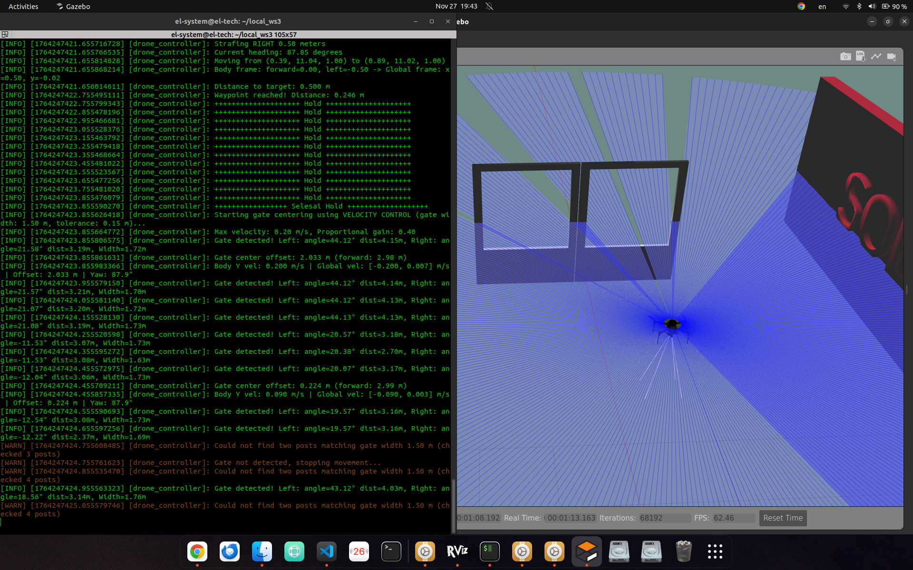

# LIDAR-Based Gate Detection and Centering for UAVs

## Overview

This project implements an autonomous gate detection and centering system for unmanned aerial vehicles (UAVs) operating in GPS-denied environments. Designed for ArduPilot-based drones, this system enables precise navigation through gates and obstacles using only 2D LIDAR sensor data.

### Project Background

In GPS-denied environments such as indoor spaces, tunnels, or areas with intentional GPS jamming, traditional positioning systems fail. This project addresses this challenge by leveraging LIDAR technology to provide real-time obstacle detection and autonomous navigation capabilities. The system is particularly useful for:

- **Autonomous drone Mission** - Navigating through sequential gates at high speed
- **Search and rescue missions** - Operating in collapsed structures or underground facilities
- **Industrial inspection** - Navigating through machinery, pipes, or confined spaces
- **Military applications** - Operations in GPS-denied or contested environments

### Technical Approach

The system uses a **2D LIDAR sensor** (such as RPLidar A1/A2 or SICK TiM series) mounted horizontally on the UAV. The LIDAR continuously scans the environment at 5-15 Hz, producing a planar map of obstacles around the drone. The core algorithm consists of three main stages:

1. **Point Cloud Processing** - Raw LIDAR data (ranges and angles) is converted into Cartesian coordinates
2. **Clustering and Object Detection** - Consecutive points are grouped into clusters representing physical objects (gate posts)
3. **Proportional Control** - The drone automatically adjusts its lateral position to center itself between detected gate posts

This approach is computationally efficient, robust to noise, and requires minimal tuning. Unlike vision-based systems, LIDAR is unaffected by lighting conditions, making it highly reliable for autonomous navigation.

### Key Features

- Real-time gate detection using clustering algorithms
- Automatic centering with proportional velocity control
- Configurable parameters for different gate sizes and environments
- ROS2-based architecture for easy integration
- Low computational overhead suitable for onboard computers
- Tested and validated in real-world flight scenarios

---

## How It Works

### 1. LIDAR Data Acquisition

The 2D LIDAR scans the environment horizontally and returns distance measurements at various angles. Each measurement is converted to a 2D point:

$$
\text{Point}_i = (x_i, y_i) = (r_i \cos \theta_i,\ r_i \sin \theta_i)
$$

where $r_i$ is the range and $\theta_i$ is the angle for measurement $i$.

### 2. Clustering

Consecutive points that are close together (distance $< d_{\text{cluster}}$) are grouped into clusters:

$$
\text{Distance} = \sqrt{(x_{i+1} - x_i)^2 + (y_{i+1} - y_i)^2} < d_{\text{cluster}}
$$

Each cluster represents a potential object (e.g., a gate post). The cluster centroid is calculated as:

$$
\text{Centroid}_k = \left(\frac{1}{n_k} \sum_{j=1}^{n_k} x_j,\ \frac{1}{n_k} \sum_{j=1}^{n_k} y_j\right)
$$

where $n_k$ is the number of points in cluster $k$.

### 3. Gate Detection

The algorithm searches for two clusters separated by a distance close to the expected gate width $w_{\text{gate}}$:

$$
|\text{Centroid}_1 - \text{Centroid}_2| \approx w_{\text{gate}}
$$

### 4. Centering Control

The gate center is calculated as the midpoint between the two post centroids:

$$
\text{GateCenter} = \left(\frac{x_1 + x_2}{2},\ \frac{y_1 + y_2}{2}\right)
$$

The lateral error (assuming the drone is at origin) is:

$$
e_{\text{lat}} = y_{\text{center}}
$$

A proportional controller generates the lateral velocity command:

$$
v_{\text{lat}} = K_p \cdot e_{\text{lat}}
$$

where $K_p$ is the proportional gain.

---

## Example Calculation

**Given:**
- Left post: $(2.0, 1.0)$ meters
- Right post: $(2.0, -1.0)$ meters

**Gate center:**

$$
\text{GateCenter} = \left(\frac{2.0 + 2.0}{2},\ \frac{1.0 + (-1.0)}{2}\right) = (2.0, 0.0)
$$

**Lateral error:**

$$
e_{\text{lat}} = 0.0
$$

**Control output:**

$$
v_{\text{lat}} = 1.0 \times 0.0 = 0.0 \text{ m/s (no correction needed)}
$$

The drone is already centered and can proceed through the gate.

---

## Visualization

---

## Project Info

**Author:** El Jausyan ~ vtol-Soeromiber  
**Date:** January 2026  
**Status:** ✅ TESTED & WORKING
